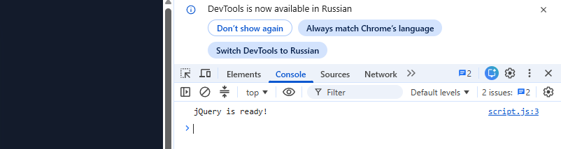
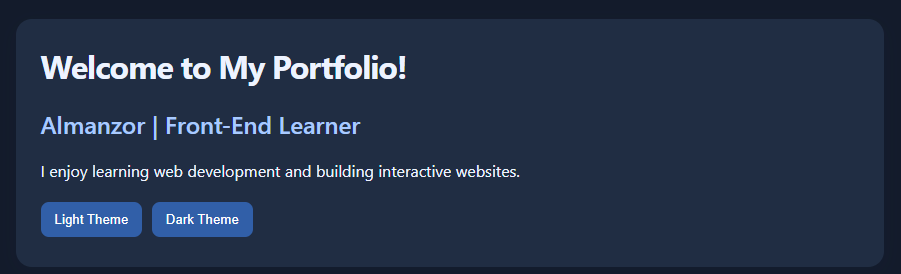
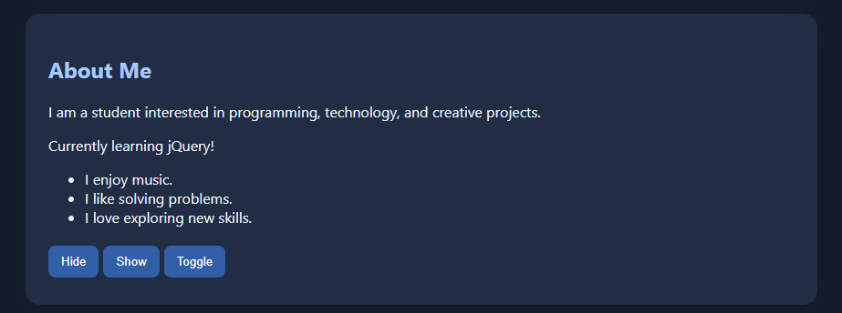
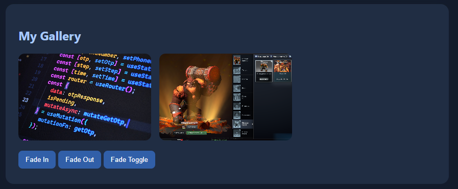
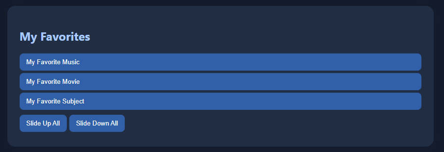
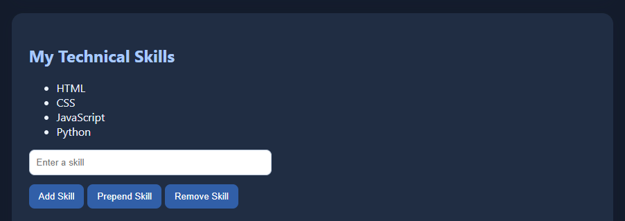
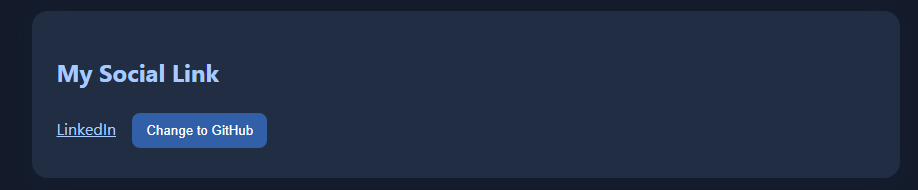
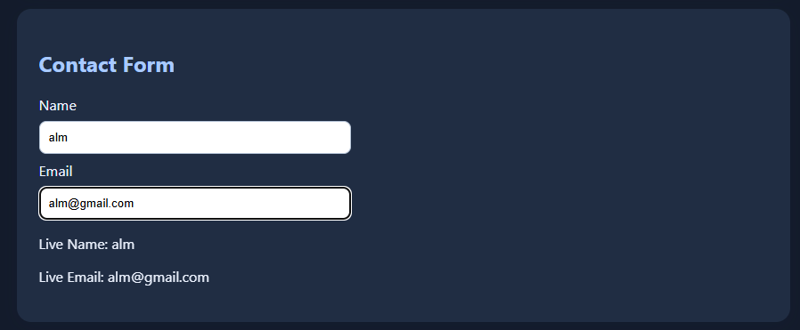
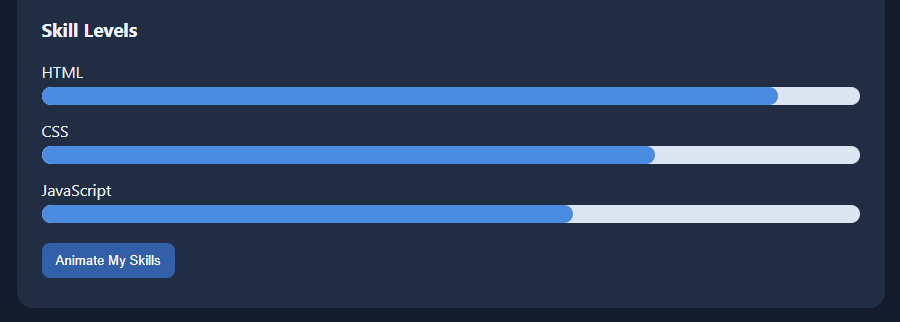

# Assignment 6 — jQuery Portfolio

**Name:** Almanzor Kamzeyev
**Group:** SE-2540

## Task 0 — Setup
jQuery 3.7.1 is loaded from a CDN. `$(document).ready()` logs `jQuery is ready!` in the browser console.

## Task 1 — Selectors & CSS
The portfolio displays a greeting, name, headline, and introduction. Tag, ID, and class selectors update text and CSS. Light and dark theme buttons are included.

## Task 2 — Visibility Methods
The About Me section contains a biography, status, and fun facts controlled by Hide, Show, and Toggle.

## Task 3 — Fade Methods
Two gallery images are controlled using `fadeIn()`, `fadeOut()`, and `fadeToggle()`.

## Task 4 — Slide Methods
Three expandable favorites panels use `slideToggle()`, `slideUp()`, and `slideDown()`.

## Task 5 — Add & Remove Elements
The skills list starts with four skills. Visitors can append, prepend, or remove skills. Empty input is rejected.

## Task 6 — Modifying Attributes
A social link switches between GitHub and LinkedIn using `attr()`.

## Task 7 — Form Interaction
Name and Email fields update the live preview using `val()` and `text()`.

## Task 8 — Basic Animation
Three skill bars start at zero width and animate to different levels, then back to zero on the next click.

## Work Process
I created the HTML portfolio structure, styled it with CSS, loaded jQuery from a CDN, and implemented selectors, effects, DOM manipulation, form interaction, and skill animations. I organized the code into separate HTML, CSS, and JavaScript files.

## Website Link

